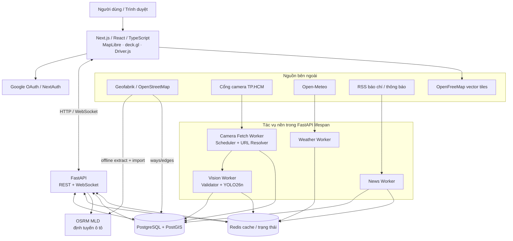
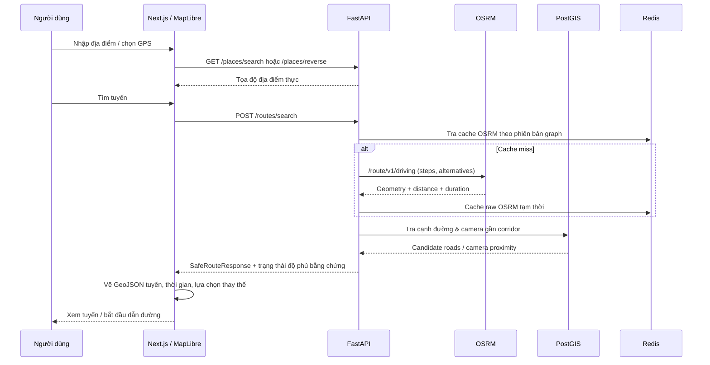
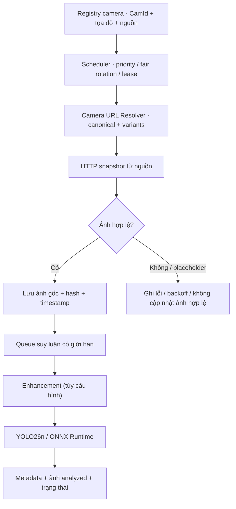
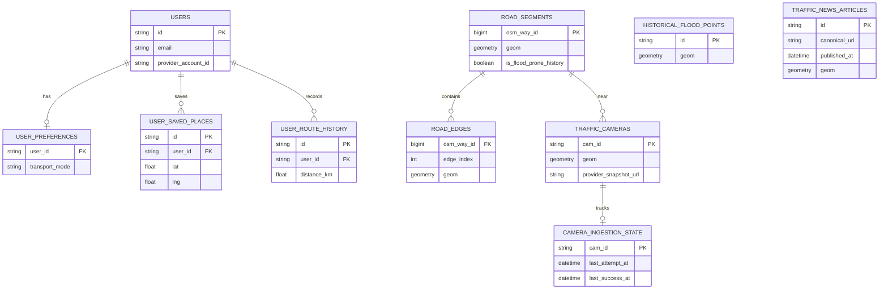

# SafePathAI

**Nền tảng bản đồ, quan trắc camera giao thông và hỗ trợ lựa chọn hành trình dựa trên bằng chứng tại TP. Hồ Chí Minh**

> **Phiên bản tài liệu:** 24/10/2026 · **Mã nguồn tham chiếu:** [`giakhoi0123/SafePathAI`](https://github.com/giakhoi0123/SafePathAI), nhánh `main`, commit [`05c8d9e`](https://github.com/giakhoi0123/SafePathAI/commit/05c8d9e668ce214643b916ab9dbcfa1072f1b0cc).  
> **Phạm vi:** README kiến trúc và vận hành của phiên bản mã nguồn ở commit trên. Đây **không phải** chứng nhận tất cả dịch vụ ngoài, dữ liệu camera hoặc API đang sẵn sàng tại thời điểm người đọc truy cập.

[Giới thiệu](#1-giới-thiệu) · [Tính năng](#3-chức-năng-và-mức-độ-hoàn-thiện) · [Kiến trúc](#4-kiến-trúc-tổng-thể) · [Cài đặt](#12-hướng-dẫn-cài-đặt-và-chạy) · [API](#11-hệ-thống-api) · [Kiểm thử](#15-kiểm-thử--chất-lượng) · [Giới hạn](#17-giới-hạn-hiện-tại-và-hướng-phát-triển)

---

## 1. Giới thiệu

**SafePathAI** là đồ án ứng dụng công nghệ phần mềm, dữ liệu không gian, bản đồ số và thị giác máy tính nhằm hỗ trợ người tham gia giao thông tại TP.HCM. Ứng dụng kết hợp dữ liệu đường OpenStreetMap, công cụ tìm đường OSRM, danh mục camera giao thông, ảnh hiện trường khi lấy được từ nguồn, kết quả nhận diện phương tiện bằng YOLO26n, dữ liệu thời tiết theo vị trí và bản tin giao thông từ các nguồn công khai.

Thay vì xem một tuyến được tính toán là **an toàn chỉ vì hệ thống không phát hiện sự cố**, SafePathAI cố gắng phân biệt ba trạng thái: **có bằng chứng về nguy cơ**, **có dữ liệu bối cảnh nhưng chưa đủ xác minh**, và **chưa có dữ liệu**. Đây là ý nghĩa của nguyên tắc **Zero-Mock in Runtime** xuyên suốt hệ thống.

### 1.1. Bài toán

- Tuyến ngắn hoặc nhanh về mặt bản đồ không đồng nghĩa với tuyến ít rủi ro trong thực địa.
- Camera tại một giao lộ chỉ quan sát được một góc nhìn; một ảnh có xe không xác nhận tốc độ/lưu lượng trung bình và ảnh không thấy nước không bảo đảm cả con đường khô ráo.
- Tin về “điểm thường ngập” khác với việc tuyến đó **đang** ngập. Tin cũ hoặc tin dự báo không được trình bày thành sự cố hiện tại.
- Ảnh CCTV độ phân giải thấp có thể bỏ sót xe máy, bị nhiễu ban đêm hoặc được máy chủ nguồn thay bằng khung `IMAGE NOT AVAILABLE` dù HTTP trả `200`.
- Người dùng cần một trải nghiệm bản đồ dễ thao tác, đọc được thời điểm cập nhật và có thể truy ngược về nguồn dữ liệu.

### 1.2. Hướng tiếp cận

1. **Định tuyến:** dùng OSRM và dữ liệu OSM thực, bảo toàn tọa độ tuyến, khoảng cách và ETA do OSRM trả về.
2. **Đối chiếu không gian:** PostGIS quản lý mạng đường, cạnh đường, camera và điểm ngập lịch sử; chỉ coi camera **gần** tuyến là bằng chứng vị trí, chưa coi đó là bằng chứng camera quan sát chính đoạn đường đó.
3. **Thị giác máy tính:** xử lý ảnh camera hợp lệ bằng ONNX Runtime + YOLO26n, giữ dấu vết nguồn và trạng thái chất lượng.
4. **Dữ liệu bổ trợ:** lấy thời tiết tại vị trí và bản tin giao thông, phân biệt thời gian công bố/sự kiện/tải dữ liệu và độ tin cậy vị trí.
5. **Giao diện:** Next.js + MapLibre cung cấp bản đồ 2D/3D, camera, tìm đường, dẫn đường bằng giọng nói, trang tin và tài khoản.
6. **Fail-closed:** thiếu nguồn, model hoặc bằng chứng thì dùng `UNKNOWN`, `UNAVAILABLE`, `STALE` hay thông báo tương ứng; không tự tạo “đường an toàn”.

### 1.3. Đối tượng sử dụng

- Người dân cần xem đường đi, camera và tin giao thông trước chuyến đi.
- Người dùng muốn tìm thông tin mưa, thời tiết khu vực gần camera/tuyến đường.
- Sinh viên, nhà phát triển hoặc hội đồng Hackathon cần kiểm tra kiến trúc, khả năng truy nguyên dữ liệu, thí nghiệm AI và độ tin cậy của kết quả.

> **Lưu ý an toàn:** SafePathAI là công cụ **hỗ trợ thông tin**, không thay thế biển báo, điều tiết giao thông, cảnh báo chính thức hoặc đánh giá thực địa. Không dùng trạng thái `UNKNOWN` để suy ra `SAFE`.

---

## 2. Công nghệ sử dụng

| Tầng | Công nghệ | Vai trò cụ thể |
| --- | --- | --- |
| Giao diện | **Next.js 14.2.15**, React 18.3, TypeScript | App Router, landing, bản đồ, dashboard, tài khoản và bản tin |
| Kiểu dáng | Tailwind CSS 3, CSS tùy chỉnh, Lucide React | Pearl Aurora / Liquid Glass, responsive, biểu tượng, hiệu ứng |
| Bản đồ | **MapLibre GL JS 4.7**, **deck.gl 9**, GeoJSON | Tiles nền, tuyến đường, camera icon/cluster, các lớp trực quan 2D/3D |
| Hướng dẫn sử dụng | **Driver.js 1.10** | Spotlight theo từng bước, onboarding, lưu lựa chọn người dùng |
| Xác thực | **NextAuth 4**, Google OAuth 2.0 | Đăng nhập Google, session JWT, đồng bộ hồ sơ người dùng |
| Backend | **FastAPI**, Python 3.12+, Pydantic v2 | REST API, WebSocket, validation và các tác vụ nền |
| Database | **PostgreSQL 15 + PostGIS**, SQLAlchemy 2, GeoAlchemy2 | Lưu tài khoản, ảnh/camera metadata, địa điểm, đường/cạnh, tin tức và truy vấn không gian |
| Cache / trạng thái | **Redis 7** | TTL, dữ liệu thời tiết/tin tức, trạng thái camera, priority queue/lease |
| Định tuyến | **OSRM** với MLD, OpenStreetMap PBF | Hình học tuyến ô tô, chỉ dẫn rẽ, khoảng cách và thời gian ước tính |
| Nhận diện xe | **Ultralytics YOLO26n → ONNX Runtime**, NumPy, OpenCV | Phát hiện `car`, `motorcycle`, `bus`, `truck`; box/class/confidence |
| Xử lý ảnh | Pillow, OpenCV | Kiểm định JPEG, nhận diện placeholder, gamma/CLAHE/denoise/unsharp |
| Thời tiết | **Open-Meteo** qua HTTPX | Nhiệt độ, gió, mưa và ngữ cảnh thời tiết theo tọa độ |
| Tin tức | RSS/HTTPX, parser XML, bộ quy tắc NLP tiếng Việt | Thu nhận, lọc, phân loại, định vị và lưu bài báo giao thông |
| Hỗ trợ AI | `mcp`/FastMCP, LLM tùy cấu hình | Công cụ truy vấn bằng chứng, tạo lời giải thích có kiểm soát |
| Tích hợp / vận hành | Docker Compose, Uvicorn, Shell, SQL | Khởi chạy phụ thuộc, nhập OSM, build OSRM, kiểm tra health |
| Kiểm thử | Pytest, Playwright, k6 | Unit/integration, E2E trình duyệt, smoke/live và tải đồng thời |

**Cần phân biệt:** MapLibre/deck.gl phục vụ *hiển thị*; OSRM mới quyết định đồ thị định tuyến. Các hiệu ứng 3D là biểu diễn thị giác, không phải bằng chứng ngập nước hay dữ liệu cảm biến.

---

## 3. Chức năng và mức độ hoàn thiện

| Phân hệ | Những gì đã có trong source | Trạng thái / ghi chú |
| --- | --- | --- |
| Landing `/` | Landing bốn cảnh theo cuộn, thành phố/bản đồ 3D, dữ liệu camera, tin nổi bật và điều hướng | **Đã triển khai giao diện**; giá trị phụ thuộc API live |
| Bản đồ `/map` | Nhập điểm đi/đến, GPS người dùng, chọn trên map, geocoding, tuyến OSRM, camera cluster/filter, 2D/3D | **Đã triển khai**; cần OSRM + dữ liệu GIS thực |
| Tìm tuyến | OSRM geometry, steps/maneuver, distance, ETA, tuyến thay thế nếu OSRM có | **Định tuyến thực**; xem giới hạn đánh giá rủi ro bên dưới |
| Phân tích rủi ro | Có `risk_engine.py`, điều kiện chứng cứ và mức `UNKNOWN/MODERATE/CRITICAL` | **Có engine riêng**, nhưng `routing.py` hiện vẫn trả `ROUTE_FOUND_RISK_UNKNOWN` và các segment `UNKNOWN` khi chưa có matching đã xác minh; **chưa thể khẳng định tối ưu an toàn đầu-cuối** |
| Camera `/monitor` | Danh mục 796 camera, tìm/lọc theo khu vực, ảnh gốc, ảnh tăng cường và ảnh phân tích nếu có | **Có đăng ký nguồn**, số camera nhận được ảnh thật thay đổi theo nguồn và worker |
| Camera trên map | Biểu tượng camera, clustering, bật/tắt, lọc có ảnh/trên tuyến, click xem modal | **Đã triển khai**; một số ảnh nguồn có thể lỗi hoặc cũ |
| YOLO26n | Có `data/models/yolo26n.onnx`, model manifest SHA-256, tiling, dual-path, NMS theo lớp | **Có runtime model thật**, trạng thái đánh giá dữ liệu TP.HCM vẫn mang tính **thử nghiệm** |
| Phân đoạn ngập từ ảnh | Pipeline ML (`scripts/ml/`), `flood_unet.onnx`, `FloodSegmenter` với ONNX Runtime | **Đã huấn luyện & kiểm định** (`VALIDATED_HCMC_ROAD_FLOOD`); IoU 0.7059, F1 0.8276, latency p95 9.5ms (125 FPS) |
| Thời tiết vị trí | Open-Meteo và Redis grid cache, mô tả hiện trạng khi có dữ liệu | **Tích hợp nguồn thật**; mất nguồn thì `WEATHER_UNAVAILABLE` |
| Thủy triều & Thủy văn | Trạm Phú An & Nhà Bè, cao độ Hòn Dấu (VN-2000), 3 cấp báo động QĐ 18/2021 | **Đã hoàn thiện pipeline** (`hydrology_observations`, Redis cache, API `/api/v1/hydrology/*`) |
| Bản tin `/news` | Tin, highlights, summary, danh mục, bộ lọc thời gian/tìm kiếm/vị trí, lưu bookmark | **Đã triển khai**; độ đầy đủ của từng adapter phụ thuộc RSS/API ngoài |
| Google login | NextAuth Google Provider, profile/preferences/places/history lưu PostgreSQL | **Có luồng OAuth**, cần cấu hình Google Client ID/Secret; bảo mật API cần gia cố trước production |
| Dashboard `/dashboard` | Thông tin tài khoản, địa điểm yêu thích, lịch sử chuyến đi, một số thẻ quan trắc | **Phần tài khoản đã có API**; biểu mẫu phản ánh cộng đồng hiện mới thêm vào React state, **chưa gửi lên server** |
| Hướng dẫn sử dụng | Driver.js theo trang, nút trợ giúp, lưu trạng thái tour trong `localStorage` | **Đã triển khai**, có bộ test UI riêng |
| Trợ lý/giọng nói | Web Speech API, chỉ dẫn rẽ, WebSocket `/ws/alerts`, MCP giải thích bằng chứng | **Có code**; trải nghiệm tùy quyền GPS, giọng tiếng Việt trên thiết bị và luồng cảnh báo thực tế |

**Không đồng nhất ba con số:** `796 camera trong danh mục` ≠ `796 camera đang có ảnh` ≠ `796 camera đủ điều kiện dùng làm chứng cứ định tuyến`.

---

## 4. Kiến trúc tổng thể

### 4.1. Sơ đồ các tầng



### 4.2. Nguyên tắc phân tách

- **Frontend** hiển thị dữ liệu, thao tác bản đồ, lấy GPS với sự đồng ý của người dùng, phát chỉ dẫn và quản lý UI state; không tự tính tuyến bằng đường thẳng.
- **FastAPI** chuẩn hóa dữ liệu, tính toán/đối chiếu, cung cấp hợp đồng JSON và đọc cache kết quả nền. `app.state.osrm_client` dùng kết nối HTTPX tái sử dụng.
- **PostGIS** làm nguồn lưu lâu dài cho thực thể không gian và người dùng; **Redis** làm cache/lease/trạng thái ngắn hạn.
- **OSRM** phục vụ tính tuyến dựa trên đồ thị lái xe biên dịch từ OSM PBF; không phải dữ liệu tắc đường trực tiếp.
- **Workers** đang được tạo bằng `asyncio.create_task(...)` trong `backend/app/main.py:lifespan`, **chưa phải các dịch vụ n8n/Make tách độc lập**. Chạy nhiều Uvicorn worker/process có thể phát sinh nhiều scheduler; cần thiết kế leader election/worker chuyên trách khi deploy scale-out.
- **MCP** là thành phần giải thích bằng chứng có thể tích hợp AI client, **không phải gateway thay thế REST** và không phải điều kiện để trang map hoạt động.

### 4.3. Luồng tổng quát của một request tìm đường



**Quan trọng:** Tại commit này `find_safe_route()` vẫn xếp thứ tự trả về theo thời gian OSRM và gán `overall_risk=UNKNOWN` khi thiếu xác minh nối step OSRM ↔ OSM Way/Edge. Không mô tả đây là thuật toán đã chứng minh tìm *tuyến ít ngập nhất* trong mọi trường hợp.

---

## 5. Các quy trình lõi (Core Pipelines)

### 5.1. Dữ liệu đường OSM → OSRM → PostGIS

**Nguồn:** [`Geofabrik Vietnam`](https://download.geofabrik.de/asia/vietnam.html) cung cấp extract OSM Việt Nam. Script `scripts/setup_osrm_hcm.sh` tải PBF và checksum MD5, kiểm chứng rồi biên dịch MLD:

```text
vietnam-latest.osm.pbf
      │ md5 checksum
      ▼
osrm-extract  (-p /opt/car.lua)
      │
      ▼
osrm-partition
      │
      ▼
osrm-customize
      │
      ▼
OSRM container (osrm-routed --algorithm mld)
```

Bản PBF cùng nguồn còn được `scripts/import_osm_roads_hcm.sh` nạp qua `osm2pgsql` (flex), `scripts/osm_roads.lua`, SQL `import_osm_roads.sql` và `build_osm_road_edges.sql`. Kết quả là:

- `road_segments`: OSM Way với `osm_way_id`, geometry, tags đường, nguồn và cờ điểm ngập lịch sử (có thể là `NULL`).
- `road_edges`: các cặp đỉnh liên tiếp của Way với `(osm_way_id, edge_index)`, khoảng cách đo bằng địa lý và chỉ mục GiST.
- Khoảng 343.610 Ways và 1.858.355 edges theo lần nhập **được ghi trong báo cáo ngày 23/10/2026**; không phải số liệu được đo lại khi tạo README.
- Kết quả gần nhau của `ST_DWithin` chỉ là **ứng viên hình học**; không tự xác nhận cạnh đó chính là edge mà OSRM chọn hay rằng một camera nhìn đúng chiều đường.

**OSRM profile:** `car.lua` dành cho **ô tô**. Người dùng có thể chọn xe máy trong hồ sơ để cá nhân hóa giao diện/ngưỡng cảnh báo, nhưng không nên hiểu ETA hoặc hạn chế đường từ OSRM đã được tính theo mạng đường dành riêng cho xe máy.

### 5.2. Camera: registry → tải ảnh → kiểm định → suy luận



- **Danh mục:** `list_camera_coordinate.txt`, importer `scripts/import_vdms_cameras.py`, bảng `traffic_cameras`, `data/cameras/camera_url_manifest.json`.
- **Resolver:** `camera_url_resolver.py` thử chiến lược URL đã có bằng chứng thành công; nguồn `CameraHandler.ashx?id=...` đôi lúc trả frame thông báo lỗi dù status HTTP 200. Không coi file JPEG/PNG giải mã được là bằng chứng camera hoạt động.
- **Validator:** `image_validator.py` kiểm tra nội dung, known hashes, perceptual/template detection, kích thước và chất lượng ảnh; frame placeholder phải bị loại trước khi nâng nét hoặc YOLO.
- **Scheduler:** `camera_scheduler.py` ưu tiên camera người dùng đang xem/trên tuyến, xử lý các camera nền theo round-robin/backoff, có lease Redis để giảm trùng lặp. `camera_ingestion_state` lưu mốc thử/tải, lỗi và hash ảnh.
- **Lưu trữ:** `storage/cams/` chứa ảnh hợp lệ; `storage/quarantine/` chứa các mẫu bị cách ly và manifest audit. Giữ **ảnh gốc**, ảnh enhanced và ảnh analyzed thành các phiên bản khác nhau.
- **Chính sách thời gian:** `last_attempt_at` (lần thử), `retrieved_at` (lần nhận thành công) và `captured_at` (thời gian ghi hình có thể chưa biết) **không được đồng nhất**. Ảnh cache cũ phải được báo là cũ.
- **Độ phủ:** cam_id/GPS không đồng nghĩa với camera có ảnh, càng không đồng nghĩa được phép dùng ảnh đó để tính rủi ro tuyến.

**Các thông số mặc định trong code (`config.py`):** `CAMERA_REFRESH_TARGET_SEC=1800` (mục tiêu quét vòng nền khoảng 30 phút), `CAMERA_SCRAPE_INTERVAL_SEC=18` (khoảng nghỉ giữa các batch), `CAMERA_BATCH_SIZE=8`, `CAMERA_MAX_CONCURRENCY=4`, `CAMERA_IMAGE_TTL_SECONDS=1800`. **Camera đang được chủ động xem/trên tuyến** có cơ chế ưu tiên khoảng **60 giây** khi điều kiện nguồn cho phép. Đây là mục tiêu scheduler, **không cam kết có frame mới mỗi phút**.

**Quyền sử dụng:** `CAMERA_INGESTION_PERMITTED`, `CAMERA_ALLOW_VIEW_ONLY`, `CAMERA_ROUTING_EVIDENCE_PERMITTED` xác định phạm vi truy xuất/xem ảnh/sử dụng làm chứng cứ. Đọc và tuân thủ điều khoản nhà cung cấp trước khi bật thu thập tự động; không bypass xác thực, hạn mức hay chống bot.

### 5.3. Computer Vision: YOLO26n & ảnh CCTV độ phân giải thấp

**Model runtime:** `data/models/yolo26n.onnx`; manifest `data/models/model_manifest.json` định nghĩa SHA-256, phiên bản, provenance, input/output và lớp cần dùng. `scripts/export_yolo26n.py` hỗ trợ export kiểm chứng từ Ultralytics (cần công cụ build model riêng; không phải runtime bắt buộc).

| Hạng mục | Thiết kế hiện có |
| --- | --- |
| Input | RGB, float32, tensor `[1,3,640,640]`, normalization `/255` |
| Output đã khai báo trong manifest | `[1,84,8400]` (one-to-many), giải mã + NMS |
| Đối tượng | COCO `car=2`, `motorcycle=3`, `bus=5`, `truck=7` |
| Detect xe nhỏ | Kết hợp full-frame, tiling 2×2, xử lý offset, NMS theo lớp và merge duplicate |
| Ngưỡng mặc định | Chung `0.25`, motorcycle `0.20`, IoU NMS `0.45` |
| Tăng cường ảnh | Gamma/CLAHE/denoise/unsharp; Super-Resolution được cấu hình riêng và mặc định tắt |
| Truy nguyên | Model name, checksum, trạng thái inference, snapshot version và ảnh nguồn |
| Phân đoạn nước | Adapter `FloodSegmenter`; **chưa có model được kiểm định** trong manifest |

Kết quả trong [`docs/YOLO26N_MIGRATION_REPORT.md`](docs/YOLO26N_MIGRATION_REPORT.md) cho biết trên một tập 25 khung hình camera, số box gắn nhãn *motorcycle* tăng từ 28 lên 57 khi dùng cấu hình dual-path + tiling, với độ trễ trung bình khoảng 200 ms cho cấu hình đó. **Đó là số lượng dự đoán**, không phải phép đo recall/AP với ground truth gán nhãn thủ công; không suy ra model có độ chính xác gấp đôi. Con số đo không đại diện mọi camera hoặc máy triển khai.

**Đặc biệt:** ảnh nguồn mờ không thể khôi phục hoàn toàn chi tiết chưa từng được ghi lại. Enhanced image là ảnh hỗ trợ thị giác; **ảnh gốc** vẫn là bằng chứng tham chiếu.

### 5.4. Thời tiết, triều và điểm ngập lịch sử

- `weather_tide.py` truy vấn **Open-Meteo**, cache dữ liệu theo ô tọa độ trong Redis khoảng 15 phút, phục vụ nhiệt độ, mưa, gió và mã điều kiện thời tiết. Dữ liệu Open-Meteo có thể là dữ liệu mô hình/dự báo theo API; không giới thiệu đó là thiết bị đo mưa trực tiếp của SafePathAI.
- Khi nguồn thời tiết không khả dụng, `rain_mm_per_hour=None` và `WEATHER_UNAVAILABLE`; **không tự điền 0 mm/h**.
- **Thủy triều:** hệ thống hỗ trợ bản tin đo trạm Phú An/Nhà Bè có nguồn, thời gian và mốc cao độ (Hòn Dấu/VN-2000), qua `ingest_verified_tide_bulletin()`. Không có bản tin được xác minh thì `TIDE_UNAVAILABLE`; mực nước trạm không phải độ sâu ngập ở một tuyến phố.
- **Điểm ngập lịch sử:** file `data/floods/hcmc_historical_flood_points.json` chứa 13 điểm được ghi trong tài liệu nguồn; `scripts/import_historical_floods.py` đưa vào bảng `historical_flood_points` và liên kết ứng viên đường. Những đường không có hồ sơ giữ trạng thái chưa rõ (`NULL`), không mặc định không ngập.
- `risk_engine.py` phân biệt bối cảnh mưa, triều, dữ liệu camera đã chuẩn hóa góc nhìn và bản tin sự cố có hiệu lực. Tuy nhiên xem mục **5.1** và **17** về phần tính rủi ro **chưa nối đầy đủ vào đường trả tuyến**.

### 5.5. Tin giao thông: nhiều nguồn → phân loại → định vị → bản tin

`backend/app/services/traffic_news.py` tổng hợp các adapter trong `services/news_sources/`:

- `vnexpress_rss.py`: tin công khai qua RSS VnExpress.
- `tuoitre_rss.py`: tin công khai qua RSS Tuổi Trẻ.
- `hcm_traffic_portal.py`: adapter thông tin cổng giao thông TP.HCM; có thể trả danh sách rỗng / ghi `BLOCKED_SOURCE` khi nguồn yêu cầu phiên truy cập.
- `official_alerts.py`: chỉ tạo mục cảnh báo từ **bản tin khí tượng/thủy văn đã có căn cứ**; không tạo thông báo ngập bằng mô phỏng.
- `nlp_classifier.py`: bộ quy tắc tiếng Việt theo nhóm ngập, ùn tắc, tai nạn, thi công, cấm đường, bối cảnh thời tiết, khắc phục; phát hiện phủ định và phân loại trạng thái thời gian.
- `hcm_geocoding.py`: đối chiếu tên đường/giao lộ/danh thắng với index PostGIS và danh mục có căn cứ; không xác định được thì `UNRESOLVED` với tọa độ null.

```text
RSS / thông báo nguồn
  → parse title, summary, canonical URL, published_at, image_url
  → lọc bài liên quan giao thông TP.HCM
  → phân loại loại tin và hiệu lực (ACTIVE_HAZARD / FORECAST / HISTORICAL / RECOVERED / UNVERIFIED)
  → geocoding, confidence & provenance
  → loại trùng, lưu traffic_news_articles
  → Redis cache → API list / highlights / summary / nearby
  → trang /news và nội dung bên cạnh tuyến/camera
```

`/news` hỗ trợ lọc theo loại, khung thời gian, tìm từ khóa, gần vị trí người dùng (khi cấp quyền GPS), danh sách/điểm nổi bật và nút mở bài gốc. **Bookmark tin** hiện được lưu trong `localStorage` của trình duyệt (`safepath_saved_news`), không phải server-side bookmark PostgreSQL.

**Chú ý:** tin xuất hiện trên RSS là bằng chứng bài viết tồn tại, **không tự động xác minh sự kiện còn đang diễn ra**. Không có tin trong feed không có nghĩa khu vực không có sự cố.

### 5.6. Công cụ đánh giá rủi ro và chính sách chứng cứ

Các nguồn có mức chứng cứ khác nhau:

| Dữ liệu | Có thể dùng làm gì | Không nên suy ra |
| --- | --- | --- |
| OSRM route | Hình học tuyến, ETA theo profile ô tô | Tắc đường live, an toàn thời tiết |
| Camera GPS | Camera gần tuyến | Camera nhìn chính đoạn đường / cùng chiều |
| Camera đã chuẩn hóa view | Chứng cứ trong góc quan sát khi đủ tươi mới và quyền sử dụng | An toàn toàn bộ đường hoặc tốc độ xe theo giờ |
| Số xe YOLO từ snapshot | Số object phát hiện trong ảnh đó | Lưu lượng xe/giờ, tốc độ hoặc toàn bộ xe có thật |
| Mưa Open-Meteo | Ngữ cảnh thời tiết theo vị trí | Mực nước trên mặt đường |
| Trạm triều | Mực nước tại trạm ở thời điểm đo | Độ sâu ngập tại nhà/đường phố |
| Điểm ngập lịch sử | Mức độ cần chú ý trong bối cảnh | Đang ngập vào thời điểm hiện tại |
| Tin đã định vị | Thông tin liên quan tuyến/khu vực | Sự cố đang tồn tại nếu bài cũ/không rõ thời gian |

Các mức `UNKNOWN`, `MODERATE`, `CRITICAL` có mặt trong contracts và risk engine. Hiện **routing API** trả về trạng thái chưa đánh giá `UNKNOWN` khi chưa đủ dữ liệu xác minh. Khác biệt giữa **có code engine** và **engine đang ảnh hưởng kết quả route API** cần được giữ minh bạch trong tài liệu/demo.

---

## 6. Luồng sử dụng ứng dụng

### 6.1. Tra cứu đường đi

1. Mở `/map`.
2. Nhập điểm xuất phát/điểm đến, chọn gợi ý OSM/Photon, dùng GPS (nếu cấp quyền), hoặc click trên bản đồ.
3. Bấm **Tìm tuyến đường**; frontend gửi `POST /api/v1/routes/search`.
4. Backend lấy OSRM geometry và spatial context, frontend vẽ tuyến màu, điểm A/B và các lựa chọn trả về.
5. Xem khoảng cách, ETA, thông tin độ phủ bằng chứng, camera liên quan và trạng thái rủi ro.
6. Chỉ khi người dùng **bắt đầu dẫn đường**, module `NavigationGuidance` mới dùng GPS watch và có tùy chọn đọc hướng dẫn bằng Web Speech API.

### 6.2. Xem camera

1. Bật **Hiển thị camera**, chọn tất cả/trên tuyến/chỉ có ảnh.
2. Phóng/thu bản đồ; MapLibre gom cluster để tránh che tuyến.
3. Click biểu tượng camera để mở modal.
4. Xem ảnh gốc, ảnh enhanced, overlay AI **nếu ảnh và output tương ứng đều hợp lệ**.
5. Kiểm tra thời gian ảnh và dữ liệu thời tiết khu vực; chọn thử lại hoặc xem nguồn khi có.

### 6.3. Xem tin tức

1. Mở `/news` từ thanh điều hướng hoặc landing.
2. Xem tin mới/highlights, bộ lọc sự cố, mốc thời gian và thông tin nguồn.
3. Tìm tin gần khu vực hoặc xem liên kết đến bài báo gốc.
4. Lưu bookmark trong trình duyệt; khả năng đồng bộ giữa nhiều thiết bị chưa được bảo đảm.

### 6.4. Hồ sơ người dùng

1. Dùng ứng dụng ở chế độ **Khách** để xem map/news/camera.
2. Nếu đã cấu hình Google OAuth, đăng nhập tại `/account`.
3. NextAuth thực hiện OAuth và cố gắng đồng bộ user vào `/api/v1/user/sync`.
4. Hồ sơ, lựa chọn loại phương tiện, địa điểm lưu và lịch sử tuyến được hiển thị/lưu qua API PostgreSQL khi kết nối hợp lệ.
5. Dashboard `/dashboard` cung cấp giao diện tài khoản/bản tin cá nhân và khu vực phản ánh. Chức năng phản ánh cộng đồng hiện mới **local UI state**, chưa phát hành thành bản tin cộng đồng thực.

### 6.5. Hướng dẫn thao tác lần đầu

`OnboardingProvider` + `OnboardingTour` sử dụng Driver.js để chỉ điểm xuất phát, điểm đến, tìm đường, bật camera, dẫn đường và trang tin; có tour ngắn riêng trên `/news`. Lựa chọn hoàn thành/bỏ qua được ghi trong `localStorage`, có thể mở lại qua nút Trợ giúp. Hướng dẫn không đồng nghĩa với dữ liệu demo runtime.

---

## 7. Backend: các module và trách nhiệm

| File | Chức năng |
| --- | --- |
| `backend/app/main.py` | Khởi tạo FastAPI, lifecycle, 4 background tasks, REST, WebSocket, OAuth/profile endpoints |
| `core/config.py` | `pydantic-settings`, `.env`, cờ camera, model, enhancement, DB/Redis/OSRM, CORS |
| `db/models.py` | ORM bảng road, edge, camera, ingestion, flood, user, saved place, route history, news |
| `db/session.py` | Async/sync SQLAlchemy sessions, Redis client, `init_db()` / `close_db()` |
| `schemas/contracts.py` | DTO và Enum: `CameraEvidence`, `SafeRouteResponse`, `WeatherTideSignal`, `RiskLevel`... |
| `services/routing.py` | OSRM request/cache, bước rẽ, kiểm tra tọa độ, query candidate edges/cameras, kết quả route |
| `services/risk_engine.py` | Quy tắc chứng cứ, đánh giá nguy cơ cho **segment đã biết identity** |
| `services/geocoding.py` | Tìm/đảo địa chỉ qua Photon và PostGIS fallback |
| `services/scraper.py` | HTTP camera, fetch có điều kiện, fallback last known good, circuit breaker |
| `services/camera_url_resolver.py` | Xác minh biến thể URL camera, lưu chiến lược thành công |
| `services/image_validator.py` | Phát hiện placeholder/corrupt/quality guard |
| `services/camera_scheduler.py` | Batch priority/round-robin, Redis lease, backoff, metrics |
| `services/camera_audit.py` | Kiểm toán kho ảnh và cách ly ảnh không hợp lệ |
| `services/vision.py` | Preprocess, enhancement, YOLO26n, FloodSegmenter adapter, overlay và provenance |
| `services/weather_tide.py` | Open-Meteo, cache, hỗ trợ bản tin thủy triều kiểm chứng |
| `services/traffic_news.py` | News aggregation, persistence, cached feed, highlights, summaries, proximity |
| `services/news_sources/*` | Các adapters + parser/NLP/geocoding nguồn tin |
| `services/mcp_explanation.py` | FastMCP tool giải thích bằng chứng và thời tiết, LLM tùy chọn |

**API docs được sinh bởi FastAPI:** khi backend chạy, mở `http://localhost:8000/docs` (Swagger UI) hoặc `http://localhost:8000/openapi.json` để xem tham số và schemas theo code đang chạy.

---

## 8. Frontend: các trang và component quan trọng

| Route / Component | Vai trò |
| --- | --- |
| `/` · `app/page.tsx` | Landing 4 scene, chuyển động scroll, camera và tin nổi bật |
| `/map` · `app/map/page.tsx` | Render `SpatialDashboard` |
| `/monitor` · `app/monitor/page.tsx` | Tổng quan camera, tìm/lọc và mở modal |
| `/news` · `app/news/page.tsx` | Bản tin, highlights, lọc, GPS gần tôi, bookmark local |
| `/dashboard` · `app/dashboard/page.tsx` | Lưu địa điểm, lịch sử, thông tin người dùng, biểu mẫu community hiện chưa persist |
| `/account` · `app/account/page.tsx` | Google account, sở thích phương tiện, nơi lưu, auth readiness |
| `SpatialDashboard.tsx` | Sidebar tìm đường, bộ điều khiển, voice HUD, dữ liệu bản đồ |
| `MapContainer.tsx` | MapLibre, tiles, route layers, camera icons/clusters, switch layers, 2D/3D |
| `CameraEvidenceModal.tsx` | Ảnh gốc/enhanced/analyzed, metadata, thời tiết, trạng thái hiện trường |
| `RouteResults.tsx` | Tuyến đề xuất và phương án thay thế |
| `NavigationGuidance.tsx` | Các bước rẽ, GPS tracking, giọng đọc web |
| `PlaceSearchCombobox.tsx` | Tìm địa điểm nhập tự do, gợi ý và GPS/chọn trên map |
| `VoiceHUD.tsx` | Thanh ngữ cảnh / điều kiện môi trường |
| `spatial/CityScene.tsx` | Bản đồ nền cinematic có pitch/parallax/particles |
| `onboarding/*`, `lib/onboarding/*` | Tour các trang, popover và lưu trạng thái |
| `context/AuthContext.tsx` | Google session + user profile state |
| `services/api.ts` | REST/WebSocket client wrappers |
| `types/contracts.ts` | TypeScript types đối chiếu backend |
| `styles/liquid-glass.css` | Hệ hiệu ứng Pearl Aurora / glass |
| `styles/onboarding.css` | Định dạng Driver.js spotlight/popover |

Next.js config có rewrite `/api/v1/*` tới `http://localhost:8000/api/v1/*` trong môi trường dev mặc định. Đồng thời `services/api.ts` dùng `NEXT_PUBLIC_API_URL` (mặc định `http://localhost:8000`) và `NEXT_PUBLIC_WS_URL` (mặc định `ws://localhost:8000`). **Khi triển khai khác máy/container, phải chỉnh cả cấu hình API và rewrite/proxy tương ứng**, không lấy `localhost` của trình duyệt làm địa chỉ backend trên cloud.

---

## 9. Cơ sở dữ liệu và Redis

### 9.1. Các bảng chính



> ERD mô tả **các thực thể nghiệp vụ chính**; xem `db/models.py` để biết schema thực, nullable fields, chỉ mục và quan hệ chính xác. Có những quan hệ không phải foreign key bắt buộc, chẳng hạn camera gần OSM Way không chứng minh đã map-match được góc quan sát.

### 9.2. Một số nguyên tắc dữ liệu

- Hình học lưu với **EPSG:4326 (WGS84)**; khoảng cách địa lý tính theo `geography` khi cần đơn vị mét.
- `traffic_cameras` lưu ID, mã, vị trí, nguồn GPS, tình trạng quyền/quan sát và URL provider.
- `camera_ingestion_state` tách lần thử, lần thành công, lần chụp, lỗi mạng, số lần retry và checksum ảnh.
- `traffic_news_articles` lưu canonical URL, nguồn, thể loại, hiệu lực, published/fetched/event/expires, geocoding status và URL ảnh báo.
- `user_saved_places`/`user_route_history` thuộc về user trong PostgreSQL; **bookmark bài báo** hiện thuộc `localStorage`.
- DB khởi tạo bảng bằng `Base.metadata.create_all()` khi startup; chưa thấy công cụ migration theo phiên bản trong cây mã nguồn (`alembic/`). **Production cần migrations và backup chính thức** trước khi đổi schema.

### 9.3. Redis

Redis dùng cho cache thời tiết (theo ô tọa độ), RSS/news, OSRM raw routes (TTL ngắn), kết quả vision và các cờ camera đang xem/trên tuyến; lease làm giảm xử lý trùng và `next_retry_at`/failure count bảo vệ nguồn bên ngoài. Redis không thay PostgreSQL làm nguồn lưu bền vững toàn bộ dữ liệu người dùng.

---

## 10. Tác vụ nền và thời gian cập nhật

| Worker trong `main.py` | Dữ liệu vào | Kết quả | Điểm cần hiểu |
| --- | --- | --- | --- |
| `background_camera_fetch_worker_loop` | Danh sách camera có quyền truy xuất | Snapshot đã qua kiểm tra, trạng thái `camera_ingestion_state`, queue inference | Batch 8, nghỉ ~18 giây, vòng nền mục tiêu ~30 phút; camera ưu tiên ~60 giây |
| `background_vision_worker_loop` | Queue ảnh hợp lệ | Detection/overlay, metrics và bằng chứng có provenance | Chỉ suy luận khi có ảnh và model hợp lệ; không dùng placeholder |
| `background_weather_worker_loop` | Open-Meteo và tình trạng bản tin triều | Redis signal có timestamp/status | Cadence tách riêng camera; dữ liệu thiếu trả UNAVAILABLE |
| `background_news_worker_loop` | RSS/nguồn thông báo | Bài đã lọc/lưu + Redis cache | Không đảm bảo nguồn ngoài luôn trả bài mới; Redis feed TTL 15 phút |

`main.py` hiện chạy các worker **bên trong tiến trình FastAPI**. Đây là kiến trúc phù hợp để thử nghiệm quy mô nhỏ. Khi scale production cần worker process độc lập, job broker, job idempotency, leader election và quản lý retry tránh khởi tạo lặp với `uvicorn --workers N`.

Các con số thời gian trong cấu hình là **mục tiêu/cadence thử truy xuất**, không phải đảm bảo độ mới của ảnh ở máy chủ camera. Trình bày riêng giờ chụp (nếu có), giờ nhận và giờ thử lại.

---

## 11. Hệ thống API

### 11.1. API REST chính

**Base URL dev:** `http://localhost:8000` · **Swagger:** `/docs`

| Method | Endpoint | Mục đích |
| --- | --- | --- |
| `GET` | `/api/v1/health` | Health PostgreSQL/Redis/OSRM/camera |
| `GET` | `/api/v1/models/status` | Tình trạng và provenance của các model |
| `GET` | `/api/v1/places/search?q=...&limit=6` | Tìm địa điểm từ chữ/tọa độ |
| `GET` | `/api/v1/places/reverse?lat=...&lng=...` | Reverse geocoding |
| `POST` | `/api/v1/routes/search` | Tìm tuyến và các phương án OSRM, trạng thái evidence |
| `GET` | `/api/v1/cameras?limit=...&offset=...` | Danh mục camera, filter `district`, `bbox` |
| `GET` | `/api/v1/cameras/summary` | Số camera đăng ký, có ảnh, trạng thái cập nhật |
| `GET` | `/api/v1/cameras/{cam_id}/metadata` | Chứng cứ, thời gian, checksum, quyền, quality |
| `GET` | `/api/v1/cameras/{cam_id}/image?type=original` | Ảnh gốc (hoặc `enhanced`, `analyzed`) nếu tồn tại |
| `POST` | `/api/v1/cameras/active-view` | Đăng ký camera đang xem để ưu tiên refresh |
| `DELETE` | `/api/v1/cameras/{cam_id}/active-view` | Hủy ưu tiên camera vừa xem |
| `POST` | `/api/v1/cameras/active-route` | Ưu tiên camera nằm dọc tuyến đang được xem |
| `GET` | `/api/v1/admin/camera-ingestion/status` | Metrics scheduler/ingestion; cần bảo vệ quyền admin khi public |
| `GET` | `/api/v1/weather-tide` | Tín hiệu mưa/thủy triều với trạng thái xác minh |
| `GET` | `/api/v1/weather/location?lat=...&lng=...` | Thời tiết theo vị trí |
| `GET` | `/api/v1/traffic-news` | Danh sách + phân trang/lọc |
| `GET` | `/api/v1/traffic-news/highlights` | Tin nổi bật |
| `GET` | `/api/v1/traffic-news/summary` | Thống kê nguồn và phân loại |
| `GET` | `/api/v1/traffic-news/nearby?lat=...&lng=...` | Tin đã định vị gần một tọa độ |
| `GET` | `/api/v1/auth/status` | Google OAuth đã đủ biến cấu hình hay chưa |
| `POST` | `/api/v1/user/sync` | Đồng bộ danh tính Google → PostgreSQL |
| `GET` | `/api/v1/user/profile` | Hồ sơ cá nhân |
| `PUT` | `/api/v1/user/preferences` | Lưu preferences |
| `POST` | `/api/v1/user/saved-places` | Lưu địa điểm |
| `DELETE` | `/api/v1/user/saved-places/{place_id}` | Xóa địa điểm |
| `POST` | `/api/v1/user/history` | Lưu lịch sử tuyến |
| `WS` | `/ws/alerts` | Kênh cảnh báo, heartbeat `ping/pong` |

**Ví dụ** tìm đường (tọa độ ví dụ chỉ phục vụ request minh họa, không phải dữ liệu camera hay kết quả tuyến tự tạo):

```bash
curl -sS http://localhost:8000/api/v1/routes/search \
  -H 'Content-Type: application/json' \
  -d '{"origin":{"lat":10.7725,"lng":106.6980},"destination":{"lat":10.8012,"lng":106.7115}}' \
  | python3 -m json.tool
```

**Ví dụ** lấy tin:

```bash
curl -sS 'http://localhost:8000/api/v1/traffic-news?limit=10&timeframe=7d' \
  | python3 -m json.tool
curl -sS 'http://localhost:8000/api/v1/cameras/summary' | python3 -m json.tool
```

Tham số yêu cầu/response có thể thay đổi; khi code và README khác nhau, **OpenAPI của phiên bản đang chạy** là hợp đồng xác nhận cuối cùng.

### 11.2. Chỉ dẫn REST ↔ WebSocket ↔ MCP

- **REST:** yêu cầu dữ liệu hiện tại, tìm đường, xem ảnh và profile.
- **WebSocket:** kênh cho frontend nhận alert/signal khi backend phát sự kiện; trạng thái `CONNECTED` chỉ chứng minh socket mở, không chứng minh đang có dữ liệu sự cố mới.
- **MCP:** `backend/app/services/mcp_explanation.py` cung cấp tool bằng chứng tuyến/thời tiết và helper giải thích; không có bằng chứng mọi lời giải thích AI đang gọi LLM mặc định. Không đặt khóa LLM trong frontend.

---

## 12. Hướng dẫn cài đặt và chạy

### 12.1. Yêu cầu tối thiểu

- macOS/Linux; Docker Engine/Desktop + Docker Compose v2.
- Python **3.12+** (phù hợp phiên bản dependency đã khóa trong `requirements.txt`), Node.js LTS và npm.
- Bộ nhớ/dung lượng đáng kể để **biên dịch OSRM cho toàn Việt Nam**. Theo [`data/osrm/README.md`](data/osrm/README.md), nên dự trù khoảng **30 GB dung lượng trống**, **16 GB RAM cho Docker VM** và từ 4 CPU cho bước xử lý dữ liệu lớn; tùy máy có thể cần cao hơn.
- Kết nối mạng để tải OSM PBF, images và truy xuất Open-Meteo/RSS/camera, tùy quyền truy cập.

### 12.2. Clone và thiết lập biến môi trường

```bash
git clone https://github.com/giakhoi0123/SafePathAI.git
cd SafePathAI
cp .env.example .env
```

Điền `.env` theo môi trường thật. **Không commit `.env`, `frontend/.env.local`, session cookie, Google Client Secret hay API keys.** Compose ở bản hiện tại chứa credential phát triển mặc định; **hãy đổi password và đưa qua env/secrets trước khi triển khai public**.

Lưu ý `DATABASE_URL` trong `.env.example` dùng placeholder `replace-with-local-password`, **không khớp** với password mặc định đang khai báo trong `docker-compose.yml`; điều chỉnh URL hoặc Compose theo cùng một password trước khi chạy backend.

### 12.3. Biên dịch OSRM (chỉ làm lại khi chưa có graph hoặc cần cập nhật dữ liệu)

```bash
./scripts/setup_osrm_hcm.sh
```

Script tải *nguyên extract Việt Nam*, xác minh MD5, chạy extract/partition/customize. Đường dẫn sản phẩm `data/osrm/vietnam-latest.osrm*` không thể tự xuất hiện chỉ nhờ `docker compose up`. Có thể xem thêm [`data/osrm/README.md`](data/osrm/README.md).

### 12.4. Chạy dịch vụ nền

**Ví dụ macOS có cổng 5000 bị chiếm:**

```bash
export OSRM_HOST_PORT=5001
docker compose up -d postgis redis osrm
OSRM_HOST_URL=http://localhost:5001 ./scripts/check_osrm.sh
```

Trên máy khác, nếu cổng 5000 trống, có thể dùng `OSRM_HOST_PORT=5000` và `OSRM_BASE_URL=http://localhost:5000`.

### 12.5. Import dữ liệu GIS và camera

```bash
# Import OSM Ways + road edges (từ PBF đã checksum)
./scripts/import_osm_roads_hcm.sh

# Import camera registry gốc
python3 scripts/import_vdms_cameras.py

# Import 13 điểm ngập lịch sử
python3 scripts/import_historical_floods.py
```

Thực hiện import trong môi trường Python đã cài requirements (xem bước sau). Đối với lần cài mới, nên chuẩn bị môi trường Python và database schema trước. Nếu script chạy lỗi do table chưa tồn tại, khởi động backend một lần để `init_db()` hoặc thực hiện bước tạo schema phù hợp rồi mới import. **Không chạy đi chạy lại lệnh import lên dữ liệu production chưa sao lưu.**

Để tránh thứ tự lệnh nhầm, quy trình khuyến nghị là: **OSRM graph → Compose services → tạo venv/cài deps → khởi động backend để tạo schema → import OSM/camera/flood → kiểm tra lại health**.

### 12.6. Backend FastAPI

```bash
python3.12 -m venv .venv
source .venv/bin/activate
python -m pip install -r requirements.txt

# Nếu OSRM ở host port 5001:
export OSRM_BASE_URL=http://localhost:5001

uvicorn backend.app.main:app --host 127.0.0.1 --port 8000 --reload
```

Tại thời điểm startup, FastAPI chạy `init_db()` và tạo bốn background tasks. Nếu chỉ muốn kiểm tra API mà chưa có quyền truy cập nguồn camera, đặt các cờ permission thích hợp; **không dùng cookie/nguồn trái phép**. `--reload` chỉ dành cho development.

Kiểm tra:

```bash
curl -sS http://localhost:8000/api/v1/health | python3 -m json.tool
curl -sS http://localhost:8000/api/v1/models/status | python3 -m json.tool
```

### 12.7. Frontend Next.js

Tạo `frontend/.env.local` ở môi trường dev với giá trị phù hợp:

```dotenv
NEXT_PUBLIC_API_URL=http://localhost:8000
NEXT_PUBLIC_WS_URL=ws://localhost:8000
NEXTAUTH_URL=http://localhost:3000
# Chỉ thêm Google credentials khi đã tạo đúng OAuth Web Client.
# AUTH_GOOGLE_ID=...
# AUTH_GOOGLE_SECRET=...
# AUTH_SECRET=...
```

```bash
cd frontend
npm ci
npm run dev
```

Truy cập **http://localhost:3000**. Nếu muốn kiểm tra production bundle:

```bash
npm run type-check
npm run build
npm run start -- -p 3100
```

Lúc chạy trên cổng 3100, điều chỉnh `NEXTAUTH_URL` và OAuth callback URI tương ứng. Không để các giá trị phát triển `localhost` trong bản triển khai cloud.

### 12.8. Google OAuth thật

1. Tạo OAuth consent screen và Web Application OAuth Client trong Google Cloud Console.
2. Khai báo authorized origin của frontend và redirect URI có dạng `http://localhost:3000/api/auth/callback/google` (hoặc cổng đang chạy).
3. Đặt **server-only** `AUTH_GOOGLE_ID`/`AUTH_GOOGLE_SECRET` (hoặc `GOOGLE_CLIENT_ID`/`GOOGLE_CLIENT_SECRET`), `AUTH_SECRET` (hoặc `NEXTAUTH_SECRET`) trong `frontend/.env.local`.
4. Khởi động lại Next.js, kiểm tra `GET /api/v1/auth/status` và sign-in flow.
5. Sửa chuẩn xác hostname/HTTPS/cookie/proxy khi triển khai thật.

**Quan trọng về bảo mật:** NextAuth đã có session, nhưng một số endpoint FastAPI quản lý user ở commit này vẫn nhận `X-User-Id` trực tiếp. **Không coi việc truyền header này là cơ chế xác thực danh tính đủ an toàn cho Internet công khai.** Trước production cần xác minh access token/JWT server-side tại API, liên kết subject với user và áp đặt quyền truy cập theo chủ sở hữu bản ghi.

### 12.9. Chạy backend trong Docker (tùy chọn)

```bash
OSRM_HOST_PORT=5001 docker compose --profile full up -d --build
```

Profile `full` dựng backend bên cạnh PostGIS/Redis/OSRM, nhưng **không bao gồm Next.js**; frontend vẫn cần chạy riêng hoặc tự thiết lập container. Các biến môi trường/secret runtime phải được truyền an toàn phù hợp. Không bật profile trước khi graph OSRM sẵn sàng.

---

## 13. Bảng biến môi trường quan trọng

| Biến | Tầng | Công dụng / mặc định tham chiếu |
| --- | --- | --- |
| `DATABASE_URL` | Backend | URL PostgreSQL với asyncpg; phải khớp Compose |
| `REDIS_URL` | Backend | `redis://localhost:6379/0` (dev host) |
| `OSRM_BASE_URL` | Backend | `http://localhost:5000` hoặc `:5001` nếu đổi host port |
| `OSRM_HOST_PORT` | Docker Compose | Port public của OSRM, container luôn nghe 5000 |
| `OSRM_GRAPH_VERSION` | Backend | Salt/version giúp invalidation cache raw OSRM |
| `OPEN_METEO_URL` | Backend | Endpoint forecast Open-Meteo |
| `HCMC_CAMERA_BASE_URL` | Backend | Base URL CameraHandler của provider |
| `HCMC_CAMERA_REFERER` | Backend | Header nguồn khi việc dùng được phép |
| `HCMC_CAMERA_COOKIE` | Backend | Session nếu người vận hành được phép sử dụng; không chia sẻ/commit |
| `CAMERA_INGESTION_PERMITTED` | Backend | Mặc định `false`, quyền ingest bằng chứng |
| `CAMERA_ALLOW_VIEW_ONLY` | Backend | Mặc định `true`, quyền xem ảnh theo cấu hình; cần đánh giá điều khoản nguồn |
| `CAMERA_ROUTING_EVIDENCE_PERMITTED` | Backend | Mặc định `false`, không nâng ảnh chưa đủ chuẩn thành chứng cứ chấm tuyến |
| `CAMERA_REFRESH_TARGET_SEC` | Backend | `1800` — mục tiêu vòng nền 30 phút |
| `CAMERA_SCRAPE_INTERVAL_SEC` | Backend | `18` — nghỉ giữa batch, **không phải** 18 giây/camera |
| `CAMERA_BATCH_SIZE` | Backend | `8` camera/batch |
| `CAMERA_MAX_CONCURRENCY` | Backend | `4` kết nối tải song song tối đa theo cấu hình |
| `CAMERA_IMAGE_TTL_SECONDS` | Backend | `1800`, ngưỡng tuổi ảnh mặc định |
| `CAMERA_DISK_EVICTION_MAX_HOURS` | Backend | `24`, chính sách dọn cache đĩa |
| `USE_MOCK_CAMERA_FALLBACK` | Backend | `false`, không dùng ảnh mock khi mất nguồn |
| `ENABLE_IMAGE_ENHANCEMENT` | Backend | `true` |
| `ENABLE_SUPER_RESOLUTION` | Backend | `false`; thiếu model SR thì không khẳng định SR đã chạy |
| `YOLO_MODEL_PATH` | Backend | `data/models/yolo26n.onnx` |
| `YOLO_CONFIDENCE_THRESHOLD` | Backend | `0.25` |
| `YOLO_MOTORCYCLE_CONF_THRESHOLD` | Backend | `0.20` |
| `LLM_API_KEY` | Backend | Tùy chọn, không cần thiết cho OSRM route |
| `CORS_ALLOWED_ORIGINS` | Backend | Danh sách frontend origin được phép; phải chỉnh production |
| `NEXT_PUBLIC_API_URL` | Frontend | REST API từ trình duyệt (`http://localhost:8000` trong dev) |
| `NEXT_PUBLIC_WS_URL` | Frontend | WebSocket URL từ trình duyệt (`ws://localhost:8000` trong dev) |
| `NEXTAUTH_URL` | Next.js | URL gốc của ứng dụng, dùng trong callback/cookies |
| `AUTH_GOOGLE_ID`, `AUTH_GOOGLE_SECRET` | Next.js server | OAuth Client ID/Secret của Google |
| `AUTH_SECRET` / `NEXTAUTH_SECRET` | Next.js server | Khóa ký/bảo vệ session |
| `INTERNAL_BACKEND_URL` | Next.js server | Backend URL cho sign-in callback đồng bộ user (mặc định `127.0.0.1:8000`) |

**Chỉ đặt `NEXT_PUBLIC_*` cho biến được phép lộ cho browser.** Không đặt session cookie, password, API key hoặc Google Client Secret vào biến `NEXT_PUBLIC_`.

---

## 14. Cấu trúc thư mục dự án

```text
SafePathAI/
├── README.md                       # Tài liệu tổng quan chính
├── Antigravity.md / Codex.md       # Quy tắc phát triển/zero-mock
├── .env.example / docker-compose.yml
├── requirements.txt / pytest.ini
│
├── backend/
│   ├── app/
│   │   ├── main.py                 # FastAPI + workers + REST/WS
│   │   ├── core/config.py          # Pydantic Settings
│   │   ├── db/                     # SQLAlchemy models & sessions
│   │   ├── schemas/contracts.py    # API contracts
│   │   └── services/
│   │       ├── routing.py, risk_engine.py, geocoding.py
│   │       ├── scraper.py, camera_scheduler.py
│   │       ├── camera_url_resolver.py, image_validator.py
│   │       ├── vision.py, camera_audit.py
│   │       ├── weather_tide.py, traffic_news.py
│   │       ├── news_sources/        # RSS/official adapters/NLP/geocoding
│   │       └── mcp_explanation.py
│   └── tests/                       # Pytest core/integration/live
│
├── frontend/
│   ├── src/app/                     # /, /map, /monitor, /news,
│   │                                # /dashboard, /account, auth route
│   ├── src/components/              # Map, dashboard, camera, guidance,
│   │   ├── onboarding/              # Driver.js providers/tour/help
│   │   ├── spatial/                 # CityScene & map visuals
│   │   └── Glass/                   # Liquid Glass UI primitives
│   ├── src/context/                 # Google auth state
│   ├── src/hooks/                   # Live observations
│   ├── src/lib/onboarding/          # Tour definitions
│   ├── src/services/api.ts          # Backend API/WS client
│   ├── src/types/contracts.ts
│   ├── src/styles/                 # Liquid Glass + onboarding styles
│   ├── e2e/                         # Playwright
│   └── package.json
│
├── data/
│   ├── osrm/                       # OSM PBF + MLD graph (build local)
│   ├── cameras/                    # URL manifest
│   ├── floods/                     # Historical flood points
│   ├── models/                     # yolo26n.onnx, manifest, legacy model
│   └── mock_cameras/               # Legacy fixtures, không dùng runtime
│
├── scripts/                          # OSRM/OSM/GIS/camera import,
│                                    # audit, benchmarks, security checks
├── storage/
│   ├── cams/                       # Valid camera snapshots (runtime)
│   └── quarantine/                 # Audited invalid frames
├── docs/                             # Báo cáo kỹ thuật, ảnh nghiệm thu
├── docker/                           # Backend Dockerfile
└── load_tests/                       # k6 route load tests
```

**Không xem mọi file trong `docs/` đều là sự thật hiện tại.** Có nhiều báo cáo thuộc các pha trước, có thể vẫn nhắc YOLOv5n, ảnh lỗi cũ hoặc cấu hình khác. Khi có khác biệt, ưu tiên **source ở commit tham chiếu + model manifest + runtime logs**.

---

## 15. Kiểm thử & chất lượng

### 15.1. Backend (Pytest)

```bash
source .venv/bin/activate
python -m pytest backend/tests/ -q
```

Chạy live tests chỉ khi PostGIS/Redis/OSRM/nguồn ngoại vi đã sẵn sàng, môi trường cho phép và đã chuẩn bị dữ liệu:

```bash
OSRM_LIVE_TESTS=1 OSM_ROAD_LIVE_TESTS=1 python -m pytest backend/tests/ -v
```

Các test quan trọng gồm `test_osrm_live.py`, `test_osm_road_graph_live.py`, `test_camera_scheduler.py`, `test_camera_60s_refresh_and_validator.py`, `test_traffic_news.py`, `test_traffic_news_nlp_benchmark.py`, `test_yolo26n_motorcycle_recovery.py`, `test_user_auth_api.py` và các bài kiểm thử trường hợp lỗi.

### 15.2. Frontend (TypeScript, build, Playwright)

```bash
cd frontend
npm run type-check
npm run build
npx playwright test
```

Cấu hình `frontend/playwright.config.ts` mặc định chạy Chromium, `baseURL=http://127.0.0.1:3100` và có thể khởi chạy Next production server trên 3100. Một số bài E2E cần backend và dữ liệu live. Thiết lập `PLAYWRIGHT_BASE_URL` / `PLAYWRIGHT_EXTERNAL_SERVER` khi dùng server hiện có.

### 15.3. Performance và bảo mật cơ bản

```bash
k6 run load_tests/k6_route_search.js
python3 scripts/security_and_redaction_check.py
```

### 15.4. Các báo cáo nghiệm thu theo thời điểm

| Nguồn | Thông tin |
| --- | --- |
| [`docs/ACCEPTANCE_EVIDENCE.md`](docs/ACCEPTANCE_EVIDENCE.md) | Một lần chạy OSRM/PostGIS/k6/Playwright ở pha trước; các con số không phải kết quả chạy lại hiện tại |
| [`docs/YOLO26N_MIGRATION_REPORT.md`](docs/YOLO26N_MIGRATION_REPORT.md) | Báo cáo migration model và benchmark detection counts/latency trên tập camera tại thời điểm chạy |
| [`docs/CAMERA_60S_REFRESH_REPORT.md`](docs/CAMERA_60S_REFRESH_REPORT.md) | Báo cáo lịch camera ưu tiên, placeholder và cache |
| [`docs/PHASE10_IMPLEMENTATION_REPORT.md`](docs/PHASE10_IMPLEMENTATION_REPORT.md) | News pipeline, camera URL resolver và 3D scene |
| [`docs/PHASE11_NEWS_AND_ONBOARDING_REPORT.md`](docs/PHASE11_NEWS_AND_ONBOARDING_REPORT.md) | Trang `/news`, highlights, Driver.js và E2E |
| [`docs/ONBOARDING_TOUR_UX_FIX.md`](docs/ONBOARDING_TOUR_UX_FIX.md) | Khắc phục blur/spotlight trong tour |
| [`docs/REAL_DATA_AI_CORE_AUDIT.md`](docs/REAL_DATA_AI_CORE_AUDIT.md) | Kiểm toán toàn diện hệ thống thủy văn, AI ngập nước và độ tin cậy của 796 camera |
| [`docs/HYDROLOGY_SOURCE_VALIDATION.md`](docs/HYDROLOGY_SOURCE_VALIDATION.md) | Báo cáo kiểm định nguồn thủy văn, trạm Phú An/Nhà Bè, phân tích triều và ngưỡng cảnh báo |
| [`docs/FLOOD_MODEL_TRAINING.md`](docs/FLOOD_MODEL_TRAINING.md) | Huấn luyện FloodUNet lightweight ONNX, benchmark độ trễ ~7.9ms và kiểm định IoU/F1 |
| [`docs/CAMERA_INGESTION_RELIABILITY.md`](docs/CAMERA_INGESTION_RELIABILITY.md) | Kiến trúc hàng đợi ưu tiên 4 bậc, chống mất ảnh LKG, atomic swap và kiểm định toàn registry 796 camera |

**Chính sách báo cáo:** không ghép số `passed/skipped` của các pha khác nhau thành một kết quả CI duy nhất; không coi tests mock/fixture là bằng chứng website đang lấy được dữ liệu camera hiện tại. Để xác nhận hôm nay, phải chạy lại và lưu log với commit SHA, timestamp, môi trường, số case và lý do skip.

---

## 16. Bảo mật, bản quyền và vận hành có trách nhiệm

### 16.1. Quyền và bảo mật

- **Không đưa** `.env`, cookie phiên ASP.NET, mật khẩu Postgres, Google OAuth secret và token LLM vào Git hoặc log.
- `frontend/src/auth.ts` sử dụng NextAuth Google; tuy nhiên một số endpoint FastAPI quản lý user dùng `X-User-Id`. **Trước triển khai Internet phải có xác minh JWT/token và kiểm soát quyền tại API**.
- Endpoint `/api/v1/admin/camera-ingestion/status` cần authorization và rate limit thực sự trước khi public nếu tiết lộ thông tin vận hành.
- Docker Compose hiện khai báo password PostgreSQL phát triển và mở ports DB/Redis trên host; khi deploy cần đổi credentials, hạn chế bindings, TLS/secret manager/network ACL.
- Không expose Redis/PostGIS/OSRM trực tiếp ra Internet nếu không cần thiết.
- Ảnh người đi đường/phương tiện có thể chứa dữ liệu riêng tư; cần giới hạn retention, mục đích sử dụng và quyền xem theo chính sách phù hợp.
- Cổng camera công cộng có thể trả lỗi/chặn; không vượt cơ chế xác thực, rate limit hoặc điều khoản của nhà cung cấp.

### 16.2. Giấy phép / nguồn dữ liệu

- Dữ liệu OSM: **ODbL**, cung cấp attribution OpenStreetMap contributors theo điều kiện tương ứng.
- Map tiles: **OpenFreeMap/OpenMapTiles** với attribution của style và chính sách nhà cung cấp; dịch vụ tile công khai không có SLA vận hành.
- YOLO26n: xem license **Ultralytics AGPL-3.0 / Enterprise** và nghĩa vụ với việc phân phối/dịch vụ đóng nguồn.
- Tin RSS và ảnh báo: tuân thủ điều khoản tái sử dụng của từng tòa soạn, chỉ lưu thông tin cần thiết và dẫn nguồn.
- Camera và thông báo cơ quan chức năng: chỉ thu thập/trình bày khi được phép; registry công khai không mặc nhiên cấp quyền dùng lại toàn bộ nội dung.

### 16.3. Không hứa quá mức

SafePathAI **không** cung cấp bảo đảm y tế, an toàn giao thông, không phải dịch vụ phản ứng khẩn cấp; không khẳng định 100% camera hoạt động, mọi xe máy được nhận diện hay đoạn đường chưa quan sát là khô ráo. Thông báo và trạng thái cần tương ứng với timestamp và nguồn đã kiểm định.

---

## 17. Giới hạn hiện tại và hướng phát triển

### 17.1. Các giới hạn đã xác định từ code

1. **Risk-aware routing chưa khép kín:** OSRM tìm được tuyến thật, nhưng kết quả trả về `UNKNOWN` khi chưa có phép khớp OSRM step ↔ OSM road edge được xác minh; chưa có bằng chứng rõ ràng rằng `calculate_segment_risk()` đang ảnh hưởng ranking của API `/routes/search`.
2. **Độ mới và độ phủ ảnh camera phụ thuộc nguồn:** `IMAGE NOT AVAILABLE`, cache cũ, time watermark không rõ và quyền truy cập có thể hạn chế dữ liệu; registry đủ 796 không có nghĩa đủ 796 stream live.
3. **Model ngập đã có weights nhưng cần lưu ý ngữ nghĩa:** `flood_unet.onnx` (lightweight FloodUNet) đã được huấn luyện, xuất ONNX và tích hợp suy luận thực tế với trạng thái `VALIDATED_HCMC_ROAD_FLOOD`. Tuy nhiên, kết quả là tỷ lệ diện tích mặt nước ngập (`water_pixel_ratio`), không được tự động suy diễn thành độ sâu nước (centimet) khi chưa có vạch chuẩn vật lý tại hiện trường.
4. **YOLO26n vẫn thử nghiệm trên miền CCTV TP.HCM:** tập benchmark có 25 frame và số box; cần dataset được gán nhãn/ground truth đủ đa dạng để báo mAP/recall theo camera/ngày/đêm.
5. **Triều chưa có nguồn quan trắc luôn sẵn sàng:** feed bulletin chỉ có khi được cung cấp và kiểm chứng.
6. **Đánh giá tin sự cố chỉ ở mức NLP/rules:** tin cũ hoặc suy diễn vị trí thiếu độ tin cậy không nên trực tiếp làm thay đổi cảnh báo tuyến.
7. **Form phản ánh cộng đồng chưa ghi backend:** handler trong `frontend/src/app/dashboard/page.tsx` đang thêm item vào React state và hiện toast, chưa lưu/phát tới user khác. Cần API, moderation, chống spam và xác minh sự cố.
8. **API user chưa đủ hardening:** phụ thuộc `X-User-Id` ở backend, cần token validation và ownership enforcement.
9. **Worker còn nằm trong process web:** chưa có job queue/leader-election hoàn chỉnh cho deployment nhiều replica.
10. **Thời tiết là dữ liệu API vùng/điểm:** không phải cảm biến nước đường phố hoặc quan trắc lượng mưa tại mỗi camera.
11. **Profile đường dành ô tô:** OSRM `car.lua` không cung cấp tuyến xe máy đã kiểm định luật giao thông xe máy.
12. **Deployment chưa hoàn chỉnh:** Compose có backend + dependencies nhưng frontend riêng, proxy/hostname và OAuth callback còn cần cấu hình production.

### 17.2. Roadmap ưu tiên

| Ưu tiên | Việc cần hoàn thiện | Tiêu chí chấp nhận |
| --- | --- | --- |
| P0 | Làm đúng và kiểm định phép ghép cạnh OSRM/OSM cho risk-aware ranking | Kết quả tuyến/segment có provenance và không chấm điểm từ camera chỉ “gần” tuyến |
| P0 | Regression ảnh camera/timestamp/placeholder trên toàn registry | `has_image` đúng với ảnh phục vụ được; stale/unknown minh bạch; nguồn không bị spam |
| P0 | Kiểm định YOLO26n trên ground-truth xe máy TP.HCM | Báo AP/recall/precision và latency p50/p95; không chỉ số box |
| P0 | Bảo vệ user API và cấu hình secret/ports | JWT validation, ownership check, rate limit và test bảo mật |
| P1 | Đưa phản ánh cộng đồng vào API có moderation | User khác xem được báo cáo thật đã qua xử lý; chống tin giả/spam |
| P1 | Tìm nguồn thủy văn/bản tin triều có thỏa thuận sử dụng | `tide_source_url`, captured/observed timestamp và datum kiểm định |
| P1 | Tách worker khỏi web process và dùng queue | Không duplicate scheduler khi scale; có monitor/alerts |
| P2 | Tối ưu hiệu năng frontend WebGL và mobile, accessibility | Core Web Vitals, memory/canvas và usability tests |
| P2 | Mở rộng workflow bằng n8n/Make nếu thực sự cần | Chỉ chuyển orchestration phù hợp, giữ CV/routing low-latency trong worker riêng |

---

## 18. Khắc phục sự cố thường gặp

| Hiện tượng | Kiểm tra | Cách xử lý |
| --- | --- | --- |
| OSRM `503` / không tìm tuyến | `docker compose ps`, `scripts/check_osrm.sh` | Build PBF/MLD, kiểm đúng `OSRM_BASE_URL`, host port và container health |
| OSRM thiếu file graph | `ls data/osrm/vietnam-latest.osrm*` | Chạy `scripts/setup_osrm_hcm.sh`, cần đủ RAM/đĩa |
| Postgres không kết nối | URL/password/port/container | Đồng bộ `.env` với Compose; không dùng password example ở production |
| Camera URL HTTP 200 nhưng ảnh báo lỗi | Validator, hash, modal metadata | Không nhận placeholder; thử canonical variant hợp lệ, giữ last known good |
| Camera không có ảnh dù marker tồn tại | `cameras/summary`, ingestion status, permission | Danh mục/ảnh/eligibility là ba dữ liệu khác nhau; xem lỗi nguồn và retry/backoff |
| Ảnh ban đêm dù giờ tải ban ngày | `captured_at` vs `retrieved_at`, image hash, timestamp overlay | Không dùng giờ request làm giờ chụp; đánh dấu stale nếu biết ảnh cũ |
| Không nhận diện được xe máy | `models/status`, ảnh gốc, model checksum/quality | Kiểm tra YOLO26n, threshold motorcycle, tiling, nguồn ảnh mờ và annotations |
| Không có tỷ lệ nước/độ sâu ngập | `models/status` | Model phân đoạn ngập chưa khả dụng; đây là trạng thái đúng |
| Mưa `0.0 mm/h` | Weather source timestamp & status | Nếu từ Open-Meteo với status hợp lệ thì có thể là giá trị nguồn; nếu lỗi thì trả `None` |
| Thủy triều dấu `—` | `weather-tide` | Chưa có bản tin được kiểm chứng, không tự điền số đo |
| News không có bài | News summary, source adapters, cache | Kiểm tra RSS/BLOCKED_SOURCE; không tuyên bố “không có sự cố” |
| OAuth `BLOCKED_CONFIGURATION` | Frontend `.env.local`, backend `/auth/status` | Đặt Client ID, Secret, AUTH_SECRET, callback URI chính xác; restart |
| Next.js mất CSS hoặc lỗi vendor chunks | `.next` cache, nhiều dev server cùng cổng | Tắt process trùng, xóa `.next` khi đã dừng dev server, chạy lại `npm run dev` |
| Playwright không tìm được frontend | Base URL, server port 3100 | `npm run build`, kiểm `PLAYWRIGHT_BASE_URL` và backend live |
| Navigation có tiếng nhưng không đọc tiếng Việt | Browser voices, quyền autoplay | Kiểm tra `speechSynthesis.getVoices()`, hỗ trợ `vi` tùy OS/browser |

---

## 19. Tài liệu tham khảo trong repository

### Nguồn dữ liệu và vận hành

- [Định nghĩa dữ liệu và provenance](docs/DATA_PROVENANCE.md) — bản lưu pha trước, phải đối chiếu manifest mới.
- [Runbook dữ liệu thực](docs/RUNBOOK_REAL_DATA.md) — một số command/port/credentials thuộc lần chạy cũ; **ưu tiên hướng dẫn cài đặt hiện tại tại README này**.
- [OSRM/OSM setup chi tiết](data/osrm/README.md).
- [Báo cáo lỗ hổng dữ liệu và trạng thái từng pha](docs/REAL_DATA_GAP_AUDIT.md).
- [Bằng chứng nghiệm thu cũ](docs/ACCEPTANCE_EVIDENCE.md).

### Báo cáo cập nhật hơn

- [Camera registry và marker](docs/CAMERA_FULL_REGISTRY_AND_MAP_FIX_REPORT.md).
- [URL resolver và kiểm toán URL camera](docs/CAMERA_URL_AUDIT.md).
- [Worker 60s / ảnh placeholder](docs/CAMERA_60S_REFRESH_REPORT.md).
- [YOLO26n migration](docs/YOLO26N_MIGRATION_REPORT.md).
- [News pipeline và 3D](docs/PHASE10_IMPLEMENTATION_REPORT.md).
- [News + Onboarding](docs/PHASE11_NEWS_AND_ONBOARDING_REPORT.md).
- [Onboarding UX fix](docs/ONBOARDING_TOUR_UX_FIX.md).
- [Pearl Aurora UI](docs/PEARL_AURORA_GLASS_REDESIGN.md).
- [MapLibre UI 3D](docs/SPATIAL_FRONTEND.md).
- [Kiểm toán AI Core & Dữ liệu thực Phase P0](docs/REAL_DATA_AI_CORE_AUDIT.md).
- [Kiểm định nguồn Thủy văn & Thủy triều](docs/HYDROLOGY_SOURCE_VALIDATION.md).
- [Quy trình huấn luyện & triển khai Model Ngập FloodUNet](docs/FLOOD_MODEL_TRAINING.md).
- [Độ tin cậy thu thập & bảo toàn ảnh 796 Camera](docs/CAMERA_INGESTION_RELIABILITY.md).

### Tài liệu bên ngoài

- [OpenStreetMap](https://www.openstreetmap.org/copyright) / [Geofabrik](https://download.geofabrik.de/asia/vietnam.html)
- [OSRM Backend](https://project-osrm.org/)
- [PostGIS](https://postgis.net/)
- [MapLibre GL JS](https://maplibre.org/)
- [OpenFreeMap](https://openfreemap.org/)
- [Open-Meteo](https://open-meteo.com/)
- [Ultralytics YOLO26](https://docs.ultralytics.com/models/yolo26/)
- [FastAPI](https://fastapi.tiangolo.com/)
- [Next.js](https://nextjs.org/docs) / [NextAuth v4](https://next-auth.js.org/)
- [Driver.js](https://driverjs.com/)

---

## 20. Đóng góp, cập nhật tài liệu và kiểm soát chất lượng

1. Mỗi thay đổi API/schema phải cập nhật `contracts.py`, `types/contracts.ts` và ghi rõ backward compatibility.
2. Mỗi dữ liệu thật mới cần có `source_url`, giấy phép/phạm vi dùng, ngày giờ, null/unknown behavior, TTL và bài test outage.
3. Mỗi lần thay model cần update ONNX SHA-256, input/output schema, ghi benchmark có kiểm chứng và xử lý không có model.
4. Mỗi benchmark phải ghi commit, bộ dữ liệu, phần cứng, cấu hình và chỉ số có ground truth hay chỉ là số dự đoán.
5. Không đưa dữ liệu nhạy cảm vào Git; chạy `scripts/security_and_redaction_check.py` trước khi công bố.
6. Khi nâng cấp UI, giữ khả năng dùng mobile, bàn phím, reduced motion và hiển thị trạng thái chưa đủ dữ liệu.
7. Tạo PR có test và screenshot liên quan thay vì thay thế kết quả live bằng mock để demo.

---

## 21. Tổng kết

SafePathAI hiện có nền tảng tương đối đầy đủ để minh họa **một ứng dụng dữ liệu đô thị đa nguồn**: giao diện bản đồ 2D/3D, OSRM định tuyến thực, PostgreSQL/PostGIS quản lý đường và camera, Redis hỗ trợ dữ liệu trạng thái, worker camera, YOLO26n, thời tiết Open-Meteo, bản tin RSS, đăng nhập Google, hồ sơ cá nhân và hướng dẫn tương tác.

Điểm phân biệt quan trọng của dự án là **tính minh bạch của bằng chứng và dữ liệu thiếu**. Hệ thống cần tiếp tục hoàn thiện phép nối bằng chứng thực địa vào tuyến đường, đánh giá chính xác xe máy trên dữ liệu gán nhãn, đảm bảo quyền truy cập camera và gia cố bảo mật trước khi được giới thiệu như một dịch vụ công cộng hoàn chỉnh.

**Một tuyến được vẽ đúng chưa có nghĩa một tuyến được chứng minh là an toàn.** Đây vừa là nguyên tắc kỹ thuật, vừa là định hướng phát triển dài hạn của SafePathAI.
