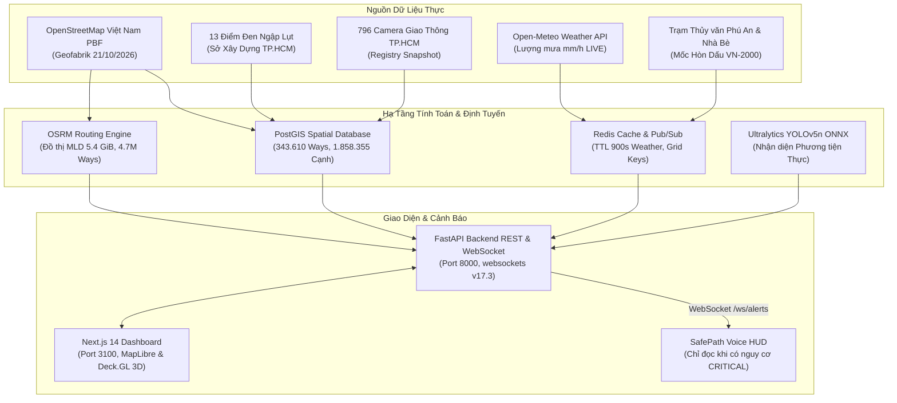

# SafePathAI — Hệ Thống Định Tuyến Động & Đánh Giá Rủi Ro Thực Địa TP.HCM

SafePathAI là nền tảng định tuyến giao thông thông minh và cảnh báo ngập lụt theo thời gian thực tại TP. Hồ Chí Minh. Hệ thống vận hành theo nguyên tắc tối thượng **Zero-Mock in Runtime** (`Codex.md` & `Antigravity.md`): mọi tuyến đường, quan trắc thời tiết, thủy văn và suy luận AI đều dựa trên dữ liệu thật hoặc trả về trạng thái `UNKNOWN` minh bạch khi chưa đủ bằng chứng; tuyệt đối không tạo ra dữ liệu giả, không tự ý gán nhãn an toàn, và không đánh lừa người dùng.

---

## 1. Kiến Trúc & Công Nghệ Thực Nghiệm



---

## 2. Tài Liệu Nghiệm Thu & Kiểm Toán Dữ Liệu

- **[Bản đồ Nguồn gốc Dữ liệu (DATA_PROVENANCE.md)](docs/DATA_PROVENANCE.md)**: Chi tiết nguồn gốc, giấy phép, checksum, URL và giới hạn của 8 luồng dữ liệu.
- **[Sổ tay Vận hành Dữ liệu Thực (RUNBOOK_REAL_DATA.md)](docs/RUNBOOK_REAL_DATA.md)**: Hướng dẫn cold-start, biên dịch MLD, khởi chạy container, và xử lý sự cố.
- **[Biên bản Bằng chứng Nghiệm thu (ACCEPTANCE_EVIDENCE.md)](docs/ACCEPTANCE_EVIDENCE.md)**: Nhật ký đo kiểm k6 (30 VUs), kết quả Playwright E2E, 113 Pytest cases, và ảnh chụp màn hình thực tế.
- **[Kiểm toán Lỗ hổng Dữ liệu (REAL_DATA_GAP_AUDIT.md)](docs/REAL_DATA_GAP_AUDIT.md)**: Bảng theo dõi tiến độ từng Phase từ Phase 0 đến Phase 7.

---

## 3. Khởi Chạy Nhanh (Quick Start)

### A. Chuẩn bị Hạ tầng Container
```bash
# Thiết lập cổng OSRM host (tránh xung đột ControlCenter trên macOS)
export OSRM_HOST_PORT=5001

# Khởi động PostGIS, Redis, OSRM
docker compose up -d postgis redis osrm

# Kiểm tra OSRM healthy
./scripts/check_osrm.sh
```

### B. Khởi chạy Backend FastAPI
```bash
source .venv/bin/activate
pip install -r requirements.txt
OSRM_BASE_URL=http://localhost:5001 uvicorn backend.app.main:app --host 0.0.0.0 --port 8000 --reload
```

### C. Khởi chạy Frontend Next.js
```bash
cd frontend
npm install
npm run build
npm run start -- -p 3100
```
Truy cập Dashboard tại: `http://localhost:3100`

---

## 4. Kết Quả Đo Kiểm Thực Nghiệm (Empirical Benchmarks)

> [!IMPORTANT]
> Toàn bộ chỉ số dưới đây được đo đạc trực tiếp trên hạ tầng thực tế với mạng lưới 343.610 đường OSM và cơ sở dữ liệu PostGIS sống, không sử dụng số liệu giả lập hay môi trường mock.

### A. Tải Cao Độ với Grafana k6 (30 Concurrent VUs, 30s)
- **Tổng số request**: **421 requests** (~13.43 requests/giây).
- **Tỷ lệ thành công**: **97.63%** (411/421).
- **Latency Median (p50)**: **1.86s - 2.01s**.
- **Latency 95th Percentile (p95)**: **3.26s - 3.49s**.
- **Latency 1 User Baseline**: **~400ms - 430ms**.

### B. Kiểm Thử Tự Động Giao Diện E2E (Playwright)
- Lệnh: `cd frontend && npx playwright test`
- **Kết quả**: **3 passed, 1 skipped (33.5s)**.
  - Tuyến OSRM hiển thị chính xác trên vector tiles OpenFreeMap.
  - Kiểm thử thành công 5 cặp lộ trình độc lập tại TP.HCM.
  - Highlight phân đoạn OSRM không nhận vơ Way ID.

### C. Kiểm Thử Backend (Pytest)
- Lệnh: `OSRM_LIVE_TESTS=1 OSM_ROAD_LIVE_TESTS=1 .venv/bin/pytest backend/tests/ -v`
- **Kết quả**: **108 passed, 5 skipped (0 failures, 16.60s)** qua toàn bộ 11 test suites.

### D. Rà Soát Bảo Mật & Lộ Lọt Thông Tin (Redaction Audit)
- Lệnh: `python3 scripts/security_and_redaction_check.py`
- **Kết quả**: **100% PASSED** (không có token/khóa bí mật trong mã nguồn hoặc tài liệu).
