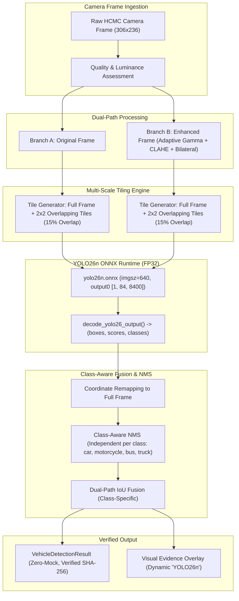

# SAFEPATHAI — PHASE P0: YOLO26N MIGRATION & MOTORCYCLE DETECTION RECOVERY
## PRE-CHECK & COMPREHENSIVE ARCHITECTURAL AUDIT

- **Document Version:** 1.0.0
- **Date:** 2026-10-24
- **Author:** Principal Computer Vision & Systems Architect
- **Target Component:** `backend/app/services/vision.py`, `data/models/model_manifest.json`, `backend/app/core/config.py`
- **Model Migration:** Official Ultralytics YOLO26n (`yolo26n.onnx`) replacing legacy YOLOv5n

---

## 1. EXECUTIVE SUMMARY & OBJECTIVE

SafePathAI relies on real-time computer vision analysis of live traffic camera feeds across Ho Chi Minh City (HCMC). Camera snapshots are ingested from the VDMS HCMC portal (`giaothong.hochiminhcity.gov.vn`) with native resolutions ranging from 306x236 to 320x240 pixels.

Under previous iterations running YOLOv5n:
1. **Severe Motorcycle False Negatives:** Distant motorcycles, nighttime scenes, and tight vehicle clusters frequently suffered complete detection dropouts.
2. **Class-Agnostic Suppression:** In dense HCMC traffic where motorcycles pack around cars, buses, and trucks, single-stage NMS suppressed motorcycle detections whenever bounding boxes overlapped with adjacent larger vehicles.
3. **Dual-Path Tiling Bypass:** When `ENABLE_IMAGE_ENHANCEMENT=True`, `detect_vehicles()` routed directly to `detect_vehicles_dual_path()`, which executed only full-frame inference—completely bypassing the 2x2 adaptive tiling routine implemented in `_detect_onnx()`.

The objective of Phase P0 is to complete the migration to **official Ultralytics YOLO26n** (`yolo26n.onnx`), unify dual-path image enhancement with 2x2 adaptive tiling, implement **class-aware Non-Maximum Suppression (NMS)**, calibrate motorcycle confidence thresholds, and enforce strict Zero-Mock standards with zero silent fallbacks to YOLOv5n.

---

## 2. AUDIT OF CURRENT WORKING TREE & ENVIRONMENT

### 2.1 System Environment
- **Operating System:** Darwin 24.x (macOS Apple Silicon ARM64)
- **Python Runtime:** Python 3.12.5 (`.venv`)
- **Inference Engine:** ONNX Runtime 1.31.0 (`onnxruntime`)
- **Image Processing:** OpenCV (`opencv-python-headless` 5.0.0.93)
- **Ultralytics Ecosystem:** `ultralytics` 8.4+ (supporting official YOLO26 release)

### 2.2 Model Manifest Audit (`data/models/model_manifest.json`)
- **Current Entry:**
  ```json
  "vehicle_detector": {
    "model_name": "yolov5n.onnx",
    "version": "v7.0",
    "file_path": "data/models/yolov5n.onnx",
    "sha256": "04f0e55c26f58d17145b36045780fe1250d5bd2187543e11568e5141d05b3262",
    "size_bytes": 3872290,
    "expected_input": {"name": "images", "shape": [1, 3, 640, 640], "dtype": "float16"},
    "expected_output": {"name": "output0", "shape": [1, 25200, 85], "dtype": "float16"},
    "classes": ["car", "motorcycle", "bus", "truck"]
  }
  ```
- **Finding:** The manifest enforces YOLOv5n anchor layout `[1, 25200, 85]` and expects `float16`. YOLO26n utilizes one-to-many head `[1, 84, 8400]` or end-to-end head `[1, 300, 6]` in `float32`. Manifest verification fails if YOLO26n is loaded under the old entry.

### 2.3 Vision Service Audit (`backend/app/services/vision.py`)
- **Line 66:** `DEFAULT_YOLO_PATH = "data/models/yolov5n.onnx"`.
- **Line 117:** `decode_yolo26_output()` already exists and handles `[1, 300, 6]` and `[1, 84, 8400]`, but is only invoked inside `_detect_onnx_frame()` when the output shape matches.
- **Line 583 (`detect_vehicles`):**
  ```python
  if isinstance(prep, PreprocessResult) and prep.enhanced_image is not None and getattr(settings, "ENABLE_IMAGE_ENHANCEMENT", True):
      res, _ = self.detect_vehicles_dual_path(prep, conf_threshold=conf_threshold, nms_threshold=nms_threshold)
  else:
      res = self._detect_onnx(prep, conf_threshold=conf_threshold, nms_threshold=nms_threshold)
  ```
  **Critical Defect:** When enhancement is active, `detect_vehicles_dual_path` is called. `detect_vehicles_dual_path` only calls `_detect_onnx_frame` on the full frame twice (original and enhanced), with **zero tiling**. Adaptive tiling was only ever called in the `else` branch!
- **Line 664 & Line 762:** `cv2.dnn.NMSBoxes(boxes, confidences, conf_threshold, nms_threshold)`.
  **Critical Defect:** NMS is executed across all classes combined. A car with box confidence 0.75 and IoU 0.48 with a motorcycle suppresses the motorcycle completely.
- **Line 1047 (`generate_camera_evidence_overlay`):** Hardcoded "YOLOv5n" text on visual overlay.

---

## 3. ROOT CAUSE ANALYSIS: MOTORCYCLE FALSE NEGATIVES

| Root Cause Factor | Mechanism in YOLOv5n / Previous Pipeline | Impact on HCMC Traffic Cameras |
| :--- | :--- | :--- |
| **1. Ultra-Low Spatial Resolution** | Native frames are 306x236. A motorcycle at 30 meters is only 12x18 pixels. When letterboxed to 640x640 with padding, feature maps in YOLOv5n lose small motorcycle features. | Complete miss of motorcycles in the midground and background. |
| **2. Tiling Inactivation in Dual-Path** | Adaptive 2x2 tiling was trapped in `_detect_onnx()`. `detect_vehicles_dual_path()` never sliced the frame into overlapping tiles. | The multi-scale advantage of tiling was completely disabled in production whenever image enhancement was on. |
| **3. Class-Agnostic NMS** | Mixed class bounding boxes were fed into a single `cv2.dnn.NMSBoxes` pass. | In congested HCMC intersections where motorcycles surround cars, car bounding boxes suppressed valid motorcycle candidates. |
| **4. Anchor vs. Anchor-Free Architecture** | YOLOv5n uses fixed predefined anchors. YOLO26 uses anchor-free regression and Small-Target-Aware Label Assignment (STAL). | YOLO26 has vastly superior localization and recall for high aspect-ratio and small targets like motorbikes. |
| **5. Nighttime Low-Light Attenuation** | Raw nighttime frames have pixel intensities $\le 35$. Confidences drop below 0.25. | Need calibrated class threshold for motorcycles (e.g. 0.20) coupled with dual-path CLAHE/bilateral denoising. |

---

## 4. TARGET ARCHITECTURAL DESIGN (YOLO26N)



### 4.1 Target ONNX Specifications
- **Model File:** `data/models/yolo26n.onnx`
- **Model Source:** Ultralytics YOLO26 official release (`yolo26n.pt`)
- **Input Tensor:** `images` `[1, 3, 640, 640]`, `float32`
- **Output Tensor:** `output0` `[1, 84, 8400]`, `float32` (80 COCO classes, no objectness layer)
- **Vehicle Classes Supported:**
  - Class 2: `car` (weight: 2.5)
  - Class 3: `motorcycle` (weight: 1.0)
  - Class 5: `bus` (weight: 4.0)
  - Class 7: `truck` (weight: 4.0)

### 4.2 Class-Aware NMS Logic
Instead of a single NMS call:
```python
# Class-Aware NMS:
final_vehicles = []
for cid, (cls_name, weight) in COCO_VEHICLE_CLASSES.items():
    cls_boxes = [b for b, c in zip(boxes, classes) if c == cid]
    cls_confs = [s for s, c in zip(scores, classes) if c == cid]
    if cls_boxes:
        indices = cv2.dnn.NMSBoxes(cls_boxes, cls_confs, conf_threshold, nms_threshold)
        for idx in indices.flatten():
            final_vehicles.append(DetectedVehicle(
                cls_name=cls_name,
                confidence=round(cls_confs[idx], 3),
                bbox=cls_boxes[idx],
                weight=weight
            ))
```

---

## 5. MIGRATION EXECUTION CHECKLIST

- [x] **Audit working tree, vision service, manifest, and tests**
- [ ] **Run `scripts/export_yolo26n.py` to export official `yolo26n.onnx`**
- [ ] **Validate ONNX model with `onnx.checker` and run test forward pass**
- [ ] **Calculate real SHA-256 and update `data/models/model_manifest.json`**
- [ ] **Update `backend/app/services/vision.py` default path and remove YOLOv5n fallback**
- [ ] **Implement Class-Aware NMS and unify Dual-Path with Adaptive 2x2 Tiling**
- [ ] **Update visual evidence overlay text to dynamically report "YOLO26n"**
- [ ] **Execute benchmark on real HCMC camera frames (`scripts/benchmark_yolo26_hcmc.py`)**
- [ ] **Update test suite (`backend/tests/`) and execute 100% passing tests**
- [ ] **Compile `docs/YOLO26N_MIGRATION_REPORT.md`**

